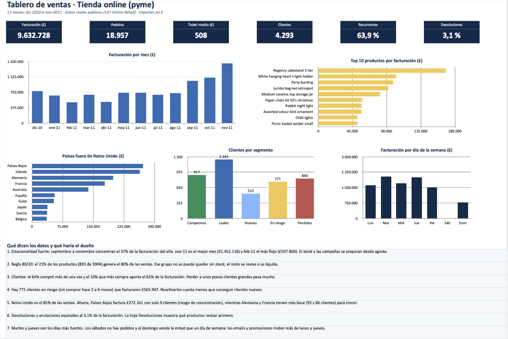

# Tablero de ventas para una pyme · Small business sales dashboard

[Español](#español) · [English](#english)



---

## Español

### El problema
Una tienda online pequeña vende miles de productos a clientes de muchos países. Tiene todos sus pedidos en una planilla, pero no sabe responder preguntas básicas: ¿qué productos sostienen el negocio?, ¿qué clientes se están yendo?, ¿cuándo conviene comprar stock y lanzar promociones?

### Los datos
- **Fuente:** [Online Retail](https://archive.ics.uci.edu/dataset/352/online+retail), UCI Machine Learning Repository (licencia CC BY 4.0).
- Transacciones **reales y anonimizadas** de una tienda online del Reino Unido que vende regalos y decoración (muchos clientes son mayoristas).
- 541.909 filas, dic-2010 a dic-2011. Importes en libras (£).
- Es un **proyecto de portfolio**, no un trabajo para un cliente.

### Qué hice
1. **Limpieza** (registrada paso a paso en la hoja *Limpieza*): quité 5.268 duplicados, separé 8.321 devoluciones para analizarlas aparte, saqué portes y comisiones que no son productos, descarté precios o cantidades en cero y dejé 12 meses completos (diciembre 2011 viene incompleto).
2. **Modelo de análisis:** ventas por mes, productos (regla 80/20), países, día y hora, devoluciones y una **segmentación de clientes RFM** (cuándo compró por última vez, cuántas veces y cuánto).
3. **Tablero en Excel** con indicadores clave, 5 gráficos y 7 conclusiones escritas para el dueño del negocio, no para un analista.

### Resultados principales
| Indicador | Valor |
|---|---|
| Facturación (12 meses) | £9.632.728 |
| Pedidos | 18.957 |
| Ticket medio | £508 |
| Clientes identificados | 4.293 |
| Clientes que repiten | 63,9 % |
| Devoluciones sobre ventas | 3,1 % |

### Qué haría el dueño con esto
1. **Preparar la temporada desde agosto:** septiembre a noviembre concentran el 37 % de la facturación del año.
2. **Proteger el stock del 21 % de productos** que genera el 80 % de las ventas.
3. **Cuidar a los clientes grandes:** el 10 % que más compra aporta el 61 % de la facturación.
4. **Reactivar 771 clientes en riesgo** que facturaron £565.947 antes de perderlos.
5. **Diversificar mercados:** Países Bajos factura mucho con solo 9 clientes; Alemania y Francia tienen más base para crecer.
6. **Programar emails y promociones de lunes a jueves:** martes y jueves son los días fuertes y los sábados no hay pedidos.

### Archivos
| Archivo | Qué es |
|---|---|
| `Tablero_Ventas_Pyme.xlsx` | El tablero y todas las tablas (se abre con Excel) |
| `analisis.py` | Limpieza y cálculos, reproducible de punta a punta |
| `power_query.m` | La misma limpieza en Power Query, para rehacerlo en Excel o Power BI |
| `xlsx_a_csv.py` | Convierte el Excel original a CSV |
| `datos/resumen.json` | Cifras finales |

### Cómo reproducirlo
```bash
pip install openpyxl xlsxwriter
# Descargar "Online Retail.xlsx" desde UCI y luego:
python3 xlsx_a_csv.py "Online Retail.xlsx" datos/online_retail.csv
python3 analisis.py datos/online_retail.csv
```

**Herramientas:** Excel, Power Query (M), Python. Hecho por Maximiliano Zanardi con apoyo de IA (Claude) para escribir el código; el enfoque, las reglas de negocio y la revisión son míos.

---

## English

### The problem
A small online shop sells thousands of products to customers in many countries. All orders sit in one spreadsheet, but the owner can't answer basic questions: which products carry the business, which customers are leaving, and when to buy stock and run promotions?

### The data
- **Source:** [Online Retail](https://archive.ics.uci.edu/dataset/352/online+retail), UCI Machine Learning Repository (CC BY 4.0).
- **Real, anonymised** transactions from a UK online gift and homeware retailer (many customers are wholesalers).
- 541,909 rows, Dec 2010 to Dec 2011. Amounts in GBP.
- This is a **portfolio project**, not client work.

### What I did
1. **Data cleaning** (logged step by step in the *Limpieza* sheet): removed 5,268 duplicates, split 8,321 returns for separate analysis, excluded postage and fees that are not products, dropped zero prices or quantities, and kept 12 full months (December 2011 is incomplete).
2. **Analysis:** monthly sales, products (80/20 rule), countries, weekday and hour, returns, and an **RFM customer segmentation** (recency, frequency, monetary value).
3. **Excel dashboard** with KPIs, 5 charts and 7 plain-language takeaways written for the business owner.

### Key results
| KPI | Value |
|---|---|
| Revenue (12 months) | £9,632,728 |
| Orders | 18,957 |
| Average order value | £508 |
| Identified customers | 4,293 |
| Repeat customers | 63.9% |
| Returns vs. sales | 3.1% |

### What the owner should do
1. **Prepare peak season from August:** September to November bring 37% of yearly revenue.
2. **Never run out of the 21% of products** that make 80% of sales.
3. **Look after key accounts:** the top 10% of customers bring 61% of revenue.
4. **Win back 771 at-risk customers** worth £565,947 before they churn.
5. **Diversify markets:** the Netherlands sells a lot through only 9 customers; Germany and France have a wider base to grow.
6. **Schedule emails and promotions Monday to Thursday:** Tuesday and Thursday are the strongest days and there are no Saturday orders.

**Tools:** Excel, Power Query (M), Python. Built by Maximiliano Zanardi, using AI (Claude) to help write the code; the approach, business rules and review are mine.

Contact: [LinkedIn](https://www.linkedin.com/in/maxizanardi)
